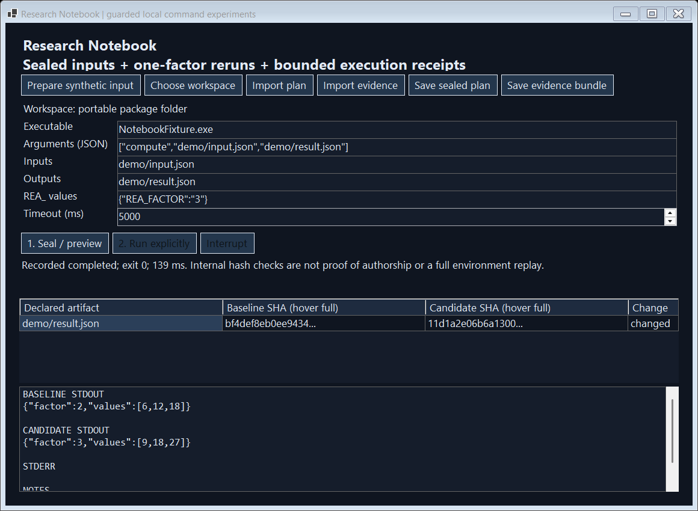

# Research Notebook

When a command produces a different result, terminal history may not tell you which input file or setting changed. This notebook records the program, chosen inputs, arguments and selected settings alongside the output, making repeat runs easier to inspect.

You ran a data-processing command last week and want to compare it with today's run. Copying the old command is only part of the story: the program, input file or settings may now be different. You need a record of the conditions you deliberately chose to track.

**Example:** The included program processes the numbers 3, 6 and 9. One run uses a multiplier of 2; another uses 3. The notebook keeps both results and shows the changed setting. Timing and existing output-file state also differ, so this is a small illustration, not a controlled performance benchmark.

**What you install:** A separate Windows command notebook and command-line tool.

**Current scope:** This is independent software, not a modified Warp terminal. It does not reproduce interactive terminal sessions, SSH connections or Warp's cloud features. Recording selected conditions cannot guarantee identical future results.

[Live guide](https://az9713.github.io/rea-warp-research/) · [Download packages](https://github.com/az9713/rea-warp-research/releases/tag/v0.1.0)

## Try the change in two minutes

1. Download and extract the Windows ZIP to a writable folder. Run **ResearchNotebook.exe**. No separate .NET install is needed.
2. Click **Prepare synthetic input**. This creates [3,6,9] locally and starts no process.
3. Click **Seal / preview**, inspect the executable, literal argument vector, input digest and explicit REA_FACTOR=2. Click **Run explicitly**. The real bundled fixture writes [6,12,18].
4. Change the environment JSON to {"REA_FACTOR":"3"}. Editing disables Run until another preview. Run again to write [9,18,27]. The grid compares the committed output against the first successful run.
5. Save a new evidence bundle. It contains the sealed plan, raw output bytes encoded as base64, artifact digests, exit state and duration. Imports verify internal commitments and start no commands. A future rerun requires a fresh local preview and an explicit click.

Full hashes appear in cell tooltips. The first completed run remains the comparison baseline for that app session. Restart to begin a new comparison session. Importing evidence does not infer that the command is safe or that its author is trustworthy.

## Before → after → experience

| Existing workflow | Implemented change | Effect on the user |
|---|---|---|
| Copy a saved command and rely on the current files and inherited shell environment. | Seal the selected executable and declared input bytes, declare a literal argv array and bounded non-secret REA_ values; clear inherited environment and use an owned profile/temp folder. | Preview explains which selected bytes drifted before launching. An ambient API token is not silently inherited. |
| Compare terminal output visually after changing a parameter. | Keep a native baseline/candidate grid, bounded exact stdout/stderr bytes and file commitments. | A factor-2 run and factor-3 run expose the changed output and preserve the exact captured evidence. |
| Interrupt a command and infer whether it finished. | Record completed, failed, interrupted, timed-out, output-limit, drift or capture refusal; request termination of the owned process tree. | An interrupted run is not labeled completed. Known parent-exit or pipe uncertainty is visible. |
| Share a note with a command and output pasted into it. | Export a new, non-overwriting plan/receipt bundle; verify consistency and optionally an independently retained receipt digest. | Readers can detect mismatched bytes and structural contradictions. They still need an independent trust channel to establish authorship. |

Warp already has command/output Blocks and runnable, parameterized notebooks and workflows. This prototype targets a narrower local execution contract, not a claim that Warp lacks notebooks. See the [official notebooks documentation](https://docs.warp.dev/knowledge-and-collaboration/warp-drive/notebooks) and [Blocks quickstart](https://docs.warp.dev/quickstart).

## What actually executes

The native desktop and CLI call the same original engine. It uses ProcessStartInfo.ArgumentList with no implicit shell, closes stdin, redirects stdout/stderr and launches a user-selected executable located inside the selected workspace. The synthetic demo launches the bundled NotebookFixture.exe. No shell, Warp process, model, cloud job or remote host participated in its verification.

Only explicit REA_ values are allowed; secret-shaped names and PATH/HOME overrides are refused. SystemRoot/WINDIR and owned temporary/profile locations are supplied by the runner. PATH is empty. This restricted environment means many ordinary developer tools need explicit adaptation; this is a bounded local experiment workbench, not a full terminal replacement.

The launcher is **not an OS sandbox**. A chosen executable can read files, access the network, spawn children and write beyond declared outputs under the user's permissions. Review commands before running. Hashes observe selected files before/after; they do not prove a complete dependency closure or rule out transient changes. Only the selected executable is hashed, not every DLL, interpreter dependency, OS component, registry value, service or network response.

## CLI

From PowerShell inside the extracted folder:

~~~powershell
.\ResearchNotebook.Cli.exe demo . .\my-new-evidence
.\ResearchNotebook.Cli.exe preview . .\my-new-evidence\plan-2.json
.\ResearchNotebook.Cli.exe verify .\my-new-evidence\plan-2.json .\my-new-evidence\receipt-2.json
.\ResearchNotebook.Cli.exe run . .\my-new-evidence\plan-2.json .\new-receipt.json
~~~

The demo explicitly launches two owned fixture processes. All output destinations must be new files. The workspace must already contain the declared relative executable and inputs. A run rechecks preconditions immediately before launch and holds an exclusive workspace execution lock. Ctrl+C requests cancellation of an owned running process. No imported command runs automatically.

## Verification and limits

- **35/35 real C# checks** cover successful file capture, real reruns, one-factor output differences, literal shell metacharacters, nonzero exit, timeout, active/pre-start cancellation, overflow, sealed child environment, concurrent refusal, input/executable drift, Unicode paths, snapshot mutation, strict imports, evidence tampering and atomic create-new writes.
- **8 real native-form checks** click Prepare, Preview and Run twice, check invalidation and verify the before/after grid against captured process output. The screenshot is that actual form, not a UI mockup.
- Published and extracted self-contained CLI/GUI packages are smoke-tested. ZIP CRC, exact file hashes, publisher licenses and ASCII/UTF16 build-path markers are checked.
- Browser showcase reads the actual native receipts. Its WebCrypto check verifies captured stdout byte commitments; native C# verifies full plan/receipt consistency. The browser does not execute commands.

Limits: Windows x64 only; no PTY, terminal emulation, interactive stdin, SSH, Warp Drive/Oz sync, cloud execution, terminal injection, or installed-Warp integration. ParentExitConfirmed means the owned parent exited, not that every descendant exited. Process-tree termination is best effort; descendant races may escape observation. Only explicitly declared files and captured streams are observed. Runtime timing and receipts are not deterministic. Hashes are not signatures; a fully rewritten/resealed bundle needs an independent anchor to detect rewriting. Symlink/reparse guards and bounded reads reduce accidents but do not create race-free filesystem isolation.

Per-plan limits: 16 inputs and 16 outputs, 1 MiB each; executable 256 MiB; 32 arguments, 1,024 characters each and 12,000 aggregate characters; 16 non-secret REA_ values up to 256 characters; 100–30,000 ms timeout; 64 KiB captured stdout and stderr each; 2 MiB JSON imports. Output overflow triggers termination and a partial-output status.

Evidence bundles can contain sensitive argument values and raw captured output. Review local exports before publishing. The built-in synthetic fixture is the only workflow exercised during this project.

## Build and test

Windows, .NET SDK 9.0.320 and Python 3.13 are used. No global package install is required. Build caches, temporary files and .NET CLI home are directed into .runtime/ by the scripts. Certificate generation and telemetry are disabled. DOTNET_EXE may name an existing SDK executable.

~~~powershell
.\scripts\test.ps1
.\scripts\publish.ps1
.\scripts\smoke.ps1
python scripts\package.py
~~~

Git Bash on Windows:

~~~bash
pwsh -NoProfile -File ./scripts/test.ps1
pwsh -NoProfile -File ./scripts/publish.ps1
pwsh -NoProfile -File ./scripts/smoke.ps1
python ./scripts/package.py
~~~

WSL cannot host this Windows Forms release natively. Invoke the Windows toolchain from the repository's mounted Windows folder:

~~~bash
powershell.exe -NoProfile -ExecutionPolicy Bypass -File ./scripts/test.ps1
powershell.exe -NoProfile -ExecutionPolicy Bypass -File ./scripts/publish.ps1
powershell.exe -NoProfile -ExecutionPolicy Bypass -File ./scripts/smoke.ps1
py.exe -3.13 ./scripts/package.py
~~~

Native Linux/WSL execution is unverified. Package.py validates recorded evidence and packages an exact allowlist; it does not run commands from imported bundles.

## Source audit and licensing

The public Warp client was inspected at immutable commit [d57d976](https://github.com/warpdotdev/warp/tree/d57d9760dba0590416eca4c94379ce7653f347b5). The pinned [Windows bootstrap](https://github.com/warpdotdev/warp/blob/d57d9760dba0590416eca4c94379ce7653f347b5/script/windows/bootstrap.ps1) can install system toolchains and invoke cloud authentication, so it was not executed under this portfolio's workspace-only boundary. This original C# route was selected instead of claiming a verified Warp client fork. [Comparison](investigation/COMPARISON.md) · [Exact public-source byte hashes](investigation/public-source/pin.json).

Original source and fixture: MIT. Microsoft runtime licenses and notices ship in the binary ZIP. No Warp implementation, private terminal history, machine inventory, model or SDK is redistributed. See [NOTICE.md](NOTICE.md).
